# Shapeshifter

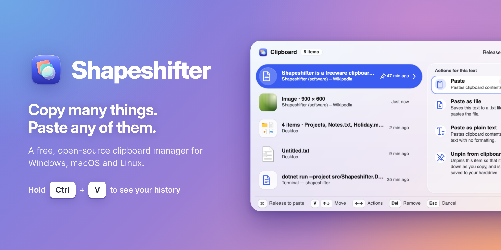

<b>Copy many things. Paste any of them.</b> A clipboard manager for Windows, macOS and Linux.

<a href="https://shapeshifter.app"><b>shapeshifter.app</b></a> · <a href="https://github.com/ffMathy/Shapeshifter/releases">Download</a>

## Hold <kbd>Ctrl</kbd>+<kbd>V</kbd>

Tap it and it pastes as always, even while you keep <kbd>Ctrl</kbd> held to paste again. Keep holding both and your history appears. Then, with <kbd>Ctrl</kbd> still held, press <kbd>V</kbd> to move and release to paste.

| Pick an item | <kbd>→</kbd> to choose what to do with it |
|---|---|
| 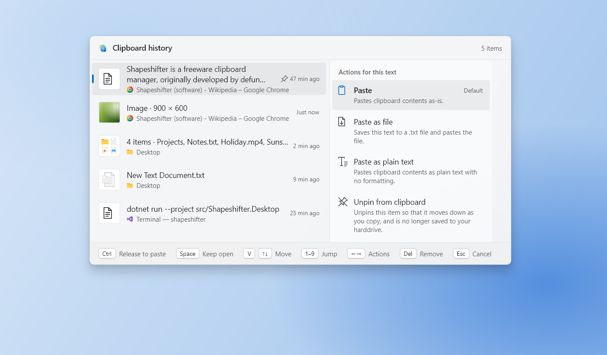 | 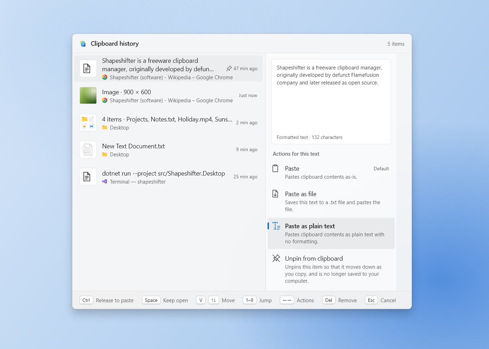 |

<kbd>1</kbd>–<kbd>9</kbd> jump to that item, <kbd>Delete</kbd> removes an item, <kbd>Esc</kbd> cancels. To look around without holding <kbd>Ctrl</kbd>, press <kbd>Space</kbd>: the history stays open until you press <kbd>Enter</kbd> to paste or <kbd>Esc</kbd>. On macOS it's <kbd>Cmd</kbd>+<kbd>V</kbd>. In Settings you can choose another shortcut instead: <kbd>Win</kbd>+<kbd>V</kbd> on Windows, in place of the Windows clipboard history, or <kbd>Ctrl</kbd>+<kbd>V</kbd> on macOS, leaving the usual paste keys alone.

Looking for something you copied a while ago? Press <kbd>S</kbd> while the history is open and type a few words:
<kbd>Enter</kbd> pastes what you found.

## At home on every platform

| Windows | macOS | Linux |
|---|---|---|
|  | 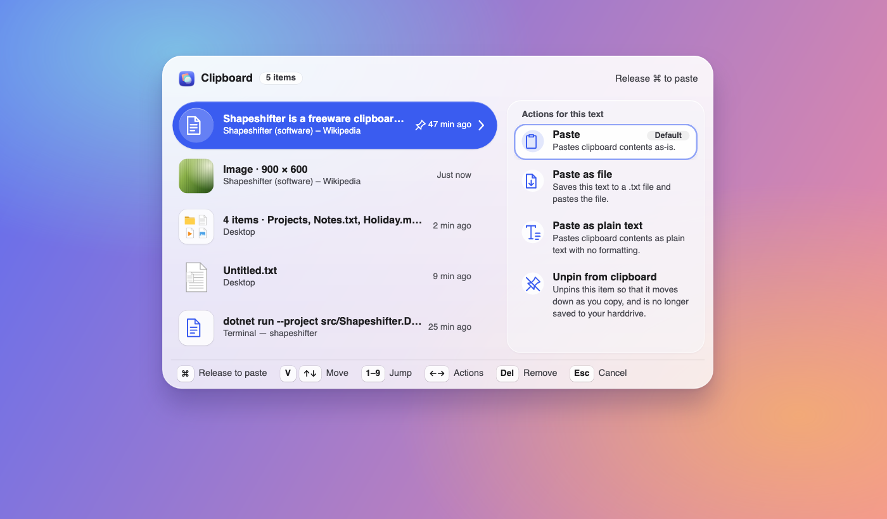 | 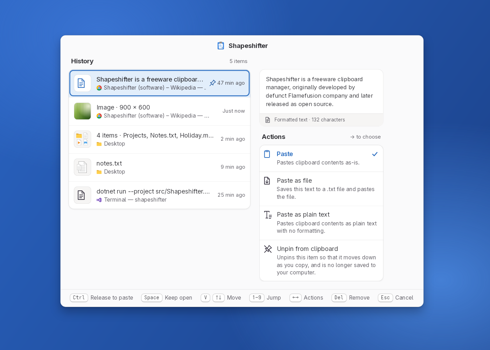 |
| 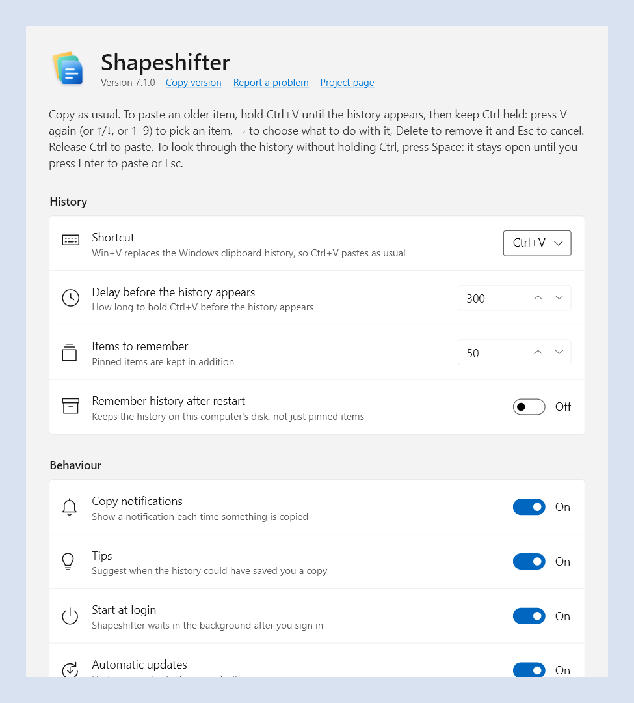 | 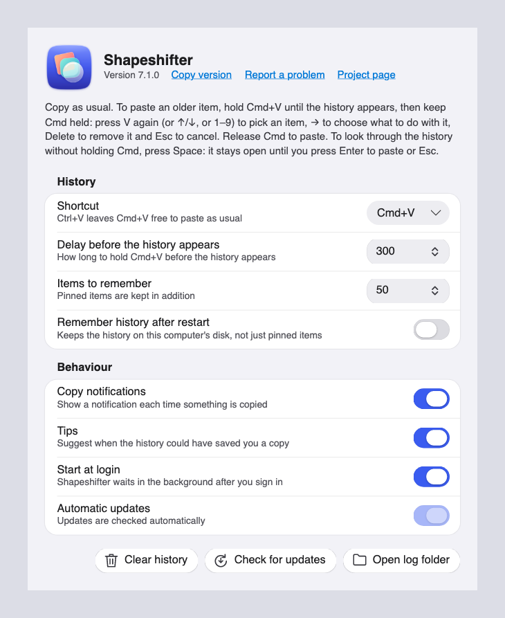 | 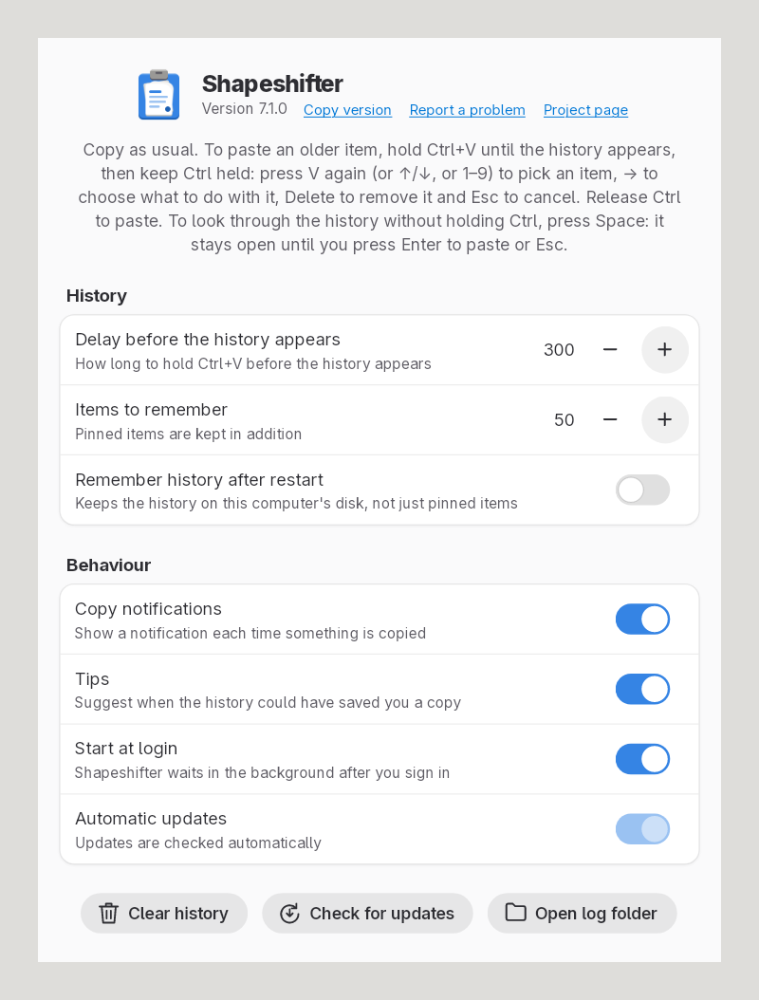 |
| 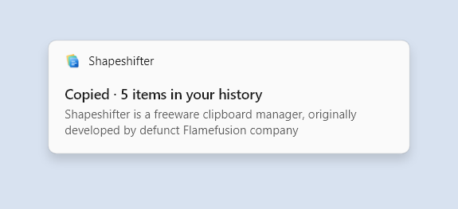 | 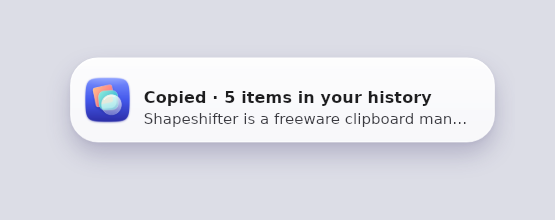 | 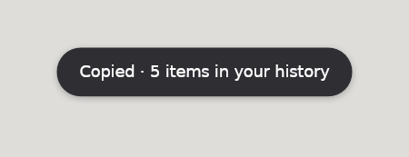 |

## In your accent colour

| | | | |
|---|---|---|---|
|  | 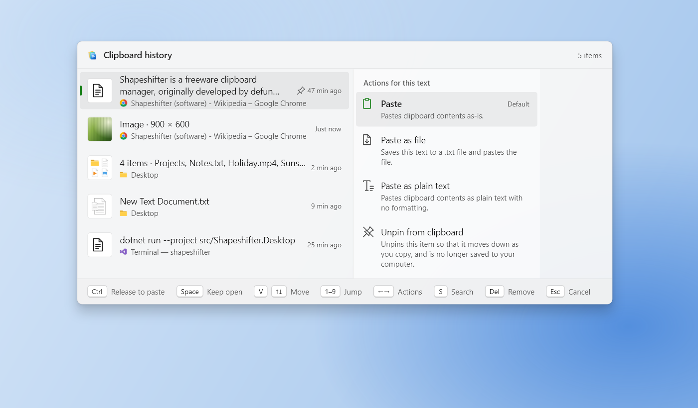 | 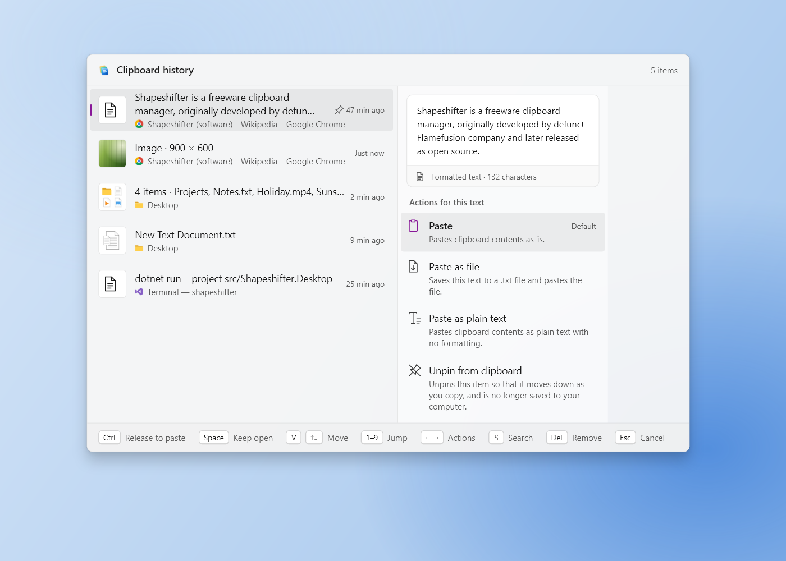 |  |

## Good to know

- **Everything is kept:** rich text, HTML, images, files and app-specific formats are restored exactly.
- **Passwords are skipped:** content that password managers mark as sensitive is never recorded.
- **Pinned items** survive restarts; turn on *Remember history after restart* in Settings to keep the rest of the
  history too.
- **Nothing you copy leaves your computer**, unless you choose **Upload and paste link** for an image. That one
  image is uploaded to [Catbox](https://catbox.moe), a free image host without ads, and a public link to it is pasted.
- **Installs and updates itself:** the first start installs Shapeshifter for your user (no administrator rights) and
  starts it at login. It checks GitHub for new releases every few hours, verifies the download's SHA-256 and restarts
  into it when you're not using it. Switch this off in Settings; on Windows, uninstall it from Apps or Control Panel.
  Starting a newer version while an older one runs closes the older one.
- **In your language:** Shapeshifter is translated into 21 languages and follows your system's language.
- **Something wrong?** *Report a problem…* in the tray menu opens a GitHub issue with your version and system filled in.
- **macOS** needs Accessibility access. **Linux** works fully on X11; on Wayland only while an X11 app is focused.

Where your data lives

| | Settings | Pinned items, saved history and logs |
|---|---|---|
| Windows | `%APPDATA%\Shapeshifter` | `%LOCALAPPDATA%\Shapeshifter` |
| macOS | `~/Library/Application Support/Shapeshifter` | same, logs in `~/Library/Logs/Shapeshifter` |
| Linux | `$XDG_CONFIG_HOME/shapeshifter` | `$XDG_DATA_HOME/shapeshifter` |

Where Shapeshifter installs itself

| | Installed to | Also |
|---|---|---|
| Windows | `%LOCALAPPDATA%\Programs\Shapeshifter` | Start menu shortcut, entry in Apps and Control Panel |
| macOS | `~/Applications/Shapeshifter.app` | |
| Linux | `~/.local/bin/shapeshifter` | desktop entry in `~/.local/share/applications` |

Run it with `--no-install` (or set `SHAPESHIFTER_NO_INSTALL=1`) to keep a copy where it is, `--uninstall` to remove the
installation (your settings and pinned items stay), and set `SHAPESHIFTER_NO_UPDATE=1` to never check for updates.

# Contributing
Feel free to contribute! See [CONTRIBUTING.md](CONTRIBUTING.md) for how to build, test and send a pull request, [docs/architecture.md](docs/architecture.md) for how the pieces fit together, and look for issues labelled [`good first issue`](https://github.com/ffMathy/Shapeshifter/labels/good%20first%20issue) to get started.

## Contributors

### Code Contributors

This project exists thanks to all the people who contribute. [[Contribute](CONTRIBUTING.md)].

### Financial Contributors

Become a financial contributor and help us sustain our community. [[Contribute](https://opencollective.com/shapeshifterclipboard/contribute)]

#### Individuals

#### Organizations

Support this project with your organization. Your logo will show up here with a link to your website. [[Contribute](https://opencollective.com/shapeshifterclipboard/contribute)]

# License
Shapeshifter is licensed under the
[Creative Commons Attribution NonCommercial](https://tldrlegal.com/license/creative-commons-attribution-noncommercial-(cc-nc)) license, which means that it's free to use
for personal use.
If you want to use Shapeshifter for commercial use, feel free to contact us.
